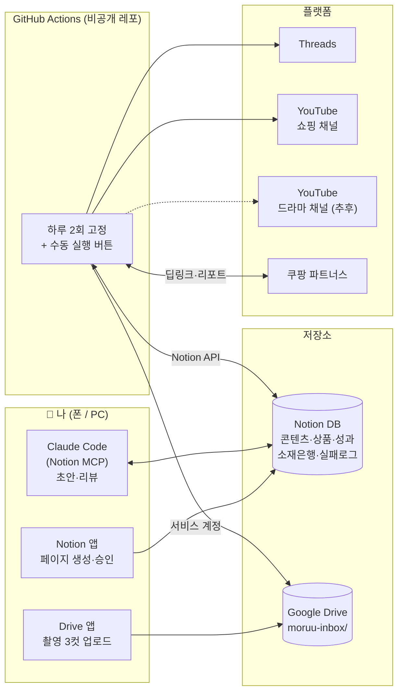
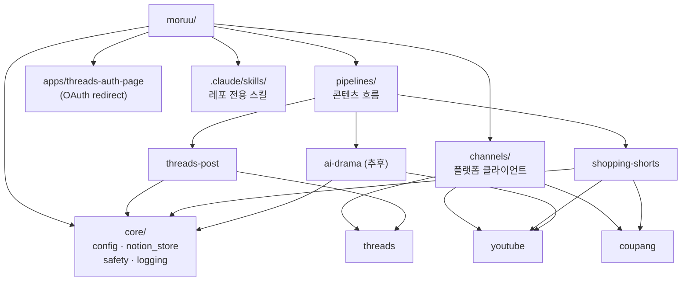
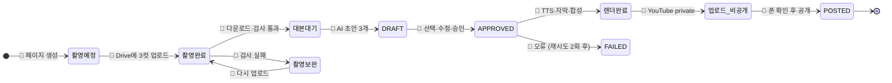
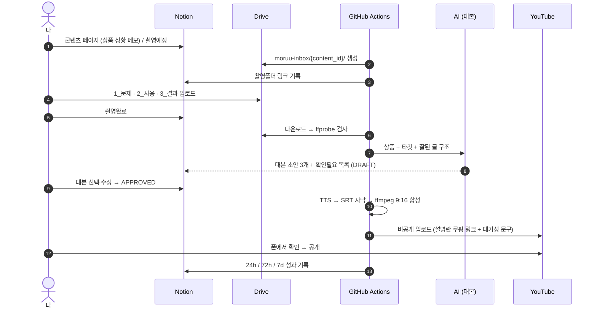
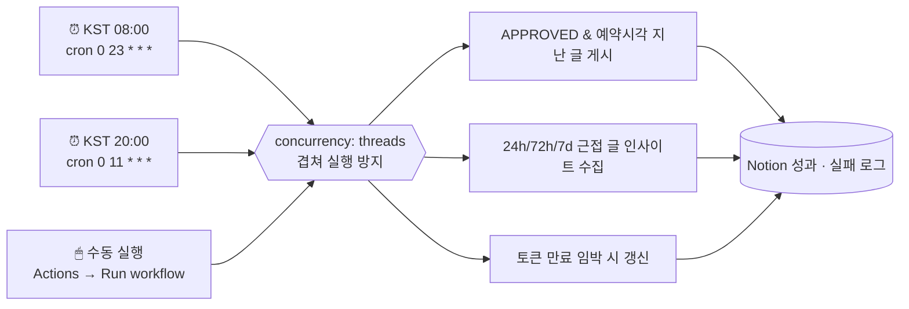
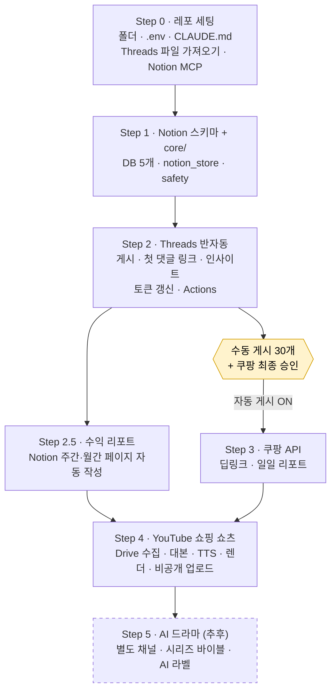
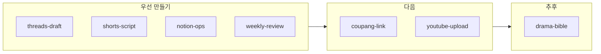

# moruu

쇼핑 콘텐츠 부업 자동화 레포. Threads · 쿠팡 파트너스 · YouTube 쇼핑 쇼츠 · (추후) AI 드라마.

- **Notion** = 운영 DB (승인·기록)
- **코드** = 반복 작업 (링크·게시·수집·렌더)
- **사람** = 촬영·승인·리뷰

상세 계획: [docs/PLAN.md](docs/PLAN.md) · 근거 자료: `../gomgom/정리/`

---

## 1. 전체 구조

> Claude(대화)는 **MCP**, 무인 스케줄러는 **Notion API 토큰** — MCP는 OAuth 대화형이라 cron에서 못 씀.

---

## 2. 레포 구조 (모노레포)

규칙: **pipelines끼리 import 금지** → `core/`, `channels/`만 공유. 채널(계정)·토큰은 쇼핑/드라마 분리.

---

## 3. 콘텐츠 상태 흐름 (Notion `status`)

- 👤 = 사람, 🤖 = 자동
- **APPROVED는 사람만 바꿈.** DRAFT·UNKNOWN 자동 게시 절대 X
- Threads 글은 `DRAFT → APPROVED → POSTED`만 사용 (촬영 단계 없음)

---

## 4. 쇼핑 쇼츠 파이프라인

원칙: **제품 장면은 실제 촬영만** · 업로드는 항상 비공개 먼저 · AI 장면 있으면 `containsSyntheticMedia=true`

---

## 5. 실행 일정 (GitHub Actions)

- 예약 실행은 수십 분 늦을 수 있음 (정각 보장 X)
- 사용량: 월 ~100분 수준 (비공개 무료 2,000분)

---

## 6. 구현 순서

---

## 7. 레포 로컬 스킬 (`.claude/skills/`)

외부 참고: Remotion 공식 스킬(드라마 단계), faceless-shorts 예제(구조 참고). 자세한 판단은 [PLAN.md §5](docs/PLAN.md).

---

## 8. 결정 현황

| # | 항목 | 상태 |
|---|---|---|
| 1 | 언어 | ✅ Python 3.12 + uv |
| 2 | Notion 플랜 | ✅ Free → 영상은 Drive |
| 3 | 스케줄러 | ✅ GitHub Actions, 하루 2회 + 수동 (KST 08:00 / 20:00) |
| 4 | TTS | ⏳ 나중에 |
| 5 | Threads 폴더 | ✅ 복사 |
| 6 | 수익 리포트 | ✅ Notion 리포트 페이지 (차트는 나중에 Looker) |
